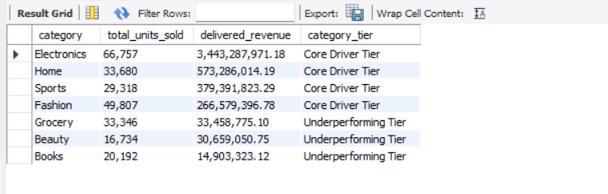
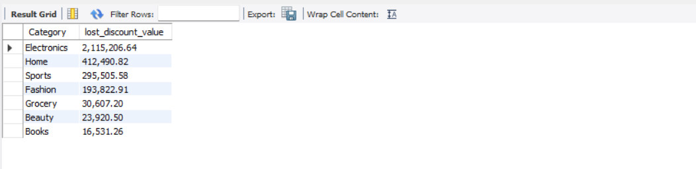
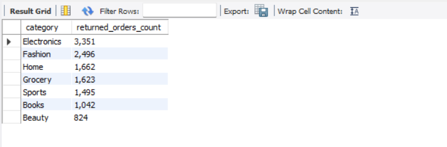
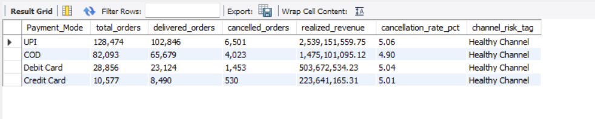
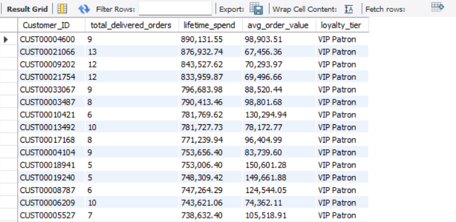

# Indian E-commerce SQL Analysis

**Problem:** Identify revenue drivers, cancellation losses, return patterns, payment-channel risk and high-value customers for an Indian e-commerce business.

## Database
**Schema:** `indian_ecommerce`
**Tables:** `customers`, `products`, `sales`
**Tool:** MySQL Workbench 8.0

## Business Questions
1. Which product categories generate the highest delivered revenue, and how do they rank by investment tier?
2. Which categories lose the most coupon discount value due to cancelled orders?
3. Which categories have the highest volume of returned orders?
4. Which payment channels process the highest realized revenue, and how do their cancellation rates rank by risk?
5. Who are the repeat customers, how much lifetime revenue do they generate, and what loyalty tier do they belong to?

## SQL Concepts Used
INNER JOIN, GROUP BY, HAVING, CASE WHEN (tiering and risk tagging), aggregate functions (SUM, COUNT, AVG), FORMAT, ROUND

## Results

### Q1. Delivered revenue by category

### Q2. Lost discount value from cancellations

### Q3. Returned orders by category

### Q4. Payment channel performance

### Q5. Repeat customers and loyalty tiers

## Key Findings
*(coming soon)*

## Files
- `sales_analysis.sql`: all queries for the project
